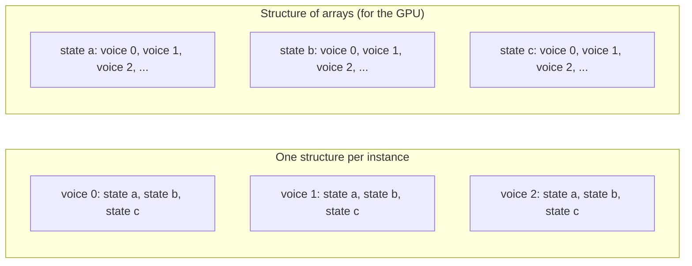
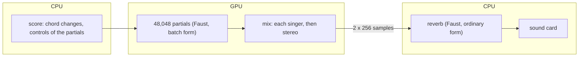

**Date:** 2026-11-08

**Audience:** a curious reader, a Faust user or a musician who wonders what a
graphics card can do for sound. No knowledge of GPUs or compilers is assumed.

French version: [mojo-gpu-synthesis-fr.md](mojo-gpu-synthesis-fr.md) (same
content; keep both versions synchronized).

**Reference documents:**

- [`faust-gpu-audio-synthesis-2026-11-07-en.md`](../porting/faust-gpu-audio-synthesis-2026-11-07-en.md),
  the measurements and the detailed verdict;
- [`mojo-backend-port-analysis-and-plan-2026-11-06-en.md`](../porting/mojo-backend-port-analysis-and-plan-2026-11-06-en.md),
  the Mojo backend;
- [`mojo-gpu-batch-of-voices-plan-2026-11-07-en.md`](../porting/mojo-gpu-batch-of-voices-plan-2026-11-07-en.md)
  and
  [`mojo-gpu-batch-g3-voice-layout-design-2026-11-07-en.md`](../porting/mojo-gpu-batch-g3-voice-layout-design-2026-11-07-en.md),
  the GPU work;
- DIFF-BACK-010 in
  [`faust-rs-vs-faust-cpp-differences-en.md`](../porting/faust-rs-vs-faust-cpp-differences-en.md),
  what differs from C++ Faust.

**Goal:** explain what the Mojo backend makes possible (running some Faust
programs on a GPU), how much computing power that brings compared with the
processor, and where the approach stops.

::: toc+
- **What is this about?** — a new output language for Faust.
- **A CPU and a GPU** — a few fast cooks or a thousand slow ones.
- **Why one Faust program does not speed up** — the time order of recursion.
- **The idea that works: many copies of the same program** — voices, partials, modes.
- **What the compiler does** — the state laid out for the GPU.
- **What was measured** — from a slower GPU to a GPU-only program.
- **CPU and GPU in the same program** — the choir in a hall.
- **Trying it** — the commands, with and without the hall.
- **The current limits** — what the approach does not do, or not yet.
- **Takeaways** — the one-page map.
:::

## 1. What is this about?

Faust describes sound processing (an oscillator, a filter, a reverb, a whole
synthesizer) as a formula. The compiler turns that formula into code in
another language: C, C++, Rust, WebAssembly, and others.

`faust-rs` can now also write **Mojo**: `faust-rs -lang mojo foo.dsp`. Mojo is
a recent language, close to Python in its syntax, compiled to fast machine
code, and designed to run the same code on a processor (CPU) or on a graphics
card (GPU). The backend follows the contract of a Mojo backend proposed for
C++ Faust (pull request grame-cncm/faust#1293), so the code it writes plugs
into the same Mojo architecture files.

On a CPU, a Faust program in Mojo computes the same thing as in C++: the
backend passes the 132 programs of the impulse-response test suite. What is
new is that the same generated code can run **on the GPU**, provided you ask
the GPU for the right thing.

## 2. A CPU and a GPU

::: definition [CPU and GPU]
A **CPU** has a few cores (10 on the machine measured here, an Apple M5),
each very fast and very flexible. A **GPU** has thousands of small arithmetic
units, each slower, grouped so that they execute the same instruction at the
same time on different data.
:::

An image helps. A CPU is a kitchen with a few excellent cooks: each one can
prepare any dish quickly, one after another. A GPU is a canteen with a
thousand cooks who are less skilled, but who all follow the same recipe at
the same moment. Ask the canteen for one gourmet dish and only one cook works,
slowly. Ask it for a thousand identical dishes and it is unbeatable.

The measurements say exactly this. One Faust reverb on the GPU runs **30 to
100 times slower** than on one CPU core:

| program | 1 copy on 1 CPU core | 1 copy on the GPU |
|---|---|---|
| `freeverb` | 14 µs | 0.56 to 1.5 ms |
| `zita_rev1` | 30 µs | 1.0 to 2.6 ms |

(times to compute a block of 256 samples, 5.3 ms of sound at 48 kHz.)

::: important [The point to remember]
The GPU is not a faster processor for one sound process. It is a very large
number of slow ones. It only pays off when it has thousands of identical,
independent tasks to do at once.
:::

## 3. Why one Faust program does not speed up

The first idea is to split one program into pieces and give each piece to a
group of GPU units. The C++ proposal tried this (its `-gpu` option): it ran
**270 to 2,600 times slower** than the CPU.

The reason is in the nature of audio. Most sound processes have **memory**:
the output of a filter depends on its previous outputs, an echo on the
samples of the last second.

```bda "A recursion: each sample needs the previous one"
_ : + ~ *(0.5)
```

Sample `n` cannot be computed before sample `n − 1`. Time imposes an order,
and that order cannot be split among a thousand cooks. Inside one program,
there are only a few independent pieces, and each costs a GPU launch.

## 4. The idea that works: many copies of the same program

The opening comes from elsewhere: many pieces of music need **thousands of
copies of the same small program**, each with its own settings, and the
copies do not depend on each other.

- **Additive synthesis**: a sound built from thousands of partials, each a
  small oscillator with its own frequency and amplitude.
- **Modal synthesis**: a bell, a plate or a room described by its resonant
  modes, each a small resonator.
- **Massive polyphony**: a cloud, a swarm, a crowd of voices.
- **Granular synthesis**: thousands of grains at once.
- **Offline work**: rendering thousands of variants of a sound, or training a
  differentiable model on many examples at once.

Here the canteen is in its element: each GPU unit runs **one copy** (an
*instance*) of the Faust program, all copies advance together, sample after
sample, and the time order is respected inside each copy.

::: definition [Instance]
One running copy of a Faust program, with its own memory (its filter states,
its delay lines) and its own controls. The Faust program describes **one**
instance; how many instances run is chosen by the host program at run time,
not written in the Faust code.
:::

This has a pleasant consequence: **no new DSP code**. A Faust program written
for one voice runs N times as it is. The generated `compute` function of one
instance becomes, unchanged, the body of each GPU thread.

## 5. What the compiler does

If the Faust code does not change, what does the compiler do? It changes
**where the memory of each instance lives**.

By default, each instance keeps its memory in its own structure, like a
binder per musician. On a GPU that is a bad idea: at each instant, the thousand
units read the same variable of a thousand different binders, scattered
everywhere in memory, and the memory cannot keep up.

`faust-rs` can lay the memory out the other way, one drawer per variable,
with the values of all the instances side by side (a "structure of arrays").
When the thousand units read "their" variable, they read neighbouring values,
in one go.



For programs with a lot of memory, this changes everything. At 4,096 voices:

| program | memory per voice | gain from the layout |
|---|---|---|
| `freeverb` | 150 KB | ×31 |
| `karplus32` (32 strings) | 482 KB | ×26 |
| `zita_rev1` | 480 KB | ×20 |

Without this layout, these programs never beat the CPU; with it, they do.
The layout changes no arithmetic: on the CPU, every voice gives bit for bit
the same result as an ordinary copy of the program, and a test in the
continuous integration checks it.

## 6. What was measured

All the figures come from one machine, an Apple M5 laptop (4 fast cores,
6 efficient cores, its integrated GPU), at 48 kHz, in blocks of 256 samples.
The budget of a block is **5.33 ms**: past it, the sound breaks up.

### 6.1 The crossover

Below some number of copies the CPU wins, above it the GPU wins. Against the
same program run one copy at a time on the CPU threads:

| program | GPU faster from | gain at 4,096 copies |
|---|---|---|
| biquad all-pass (`APF`) | 1,024 | ×3.6 |
| table oscillator (`osc`) | 1,024 | ×4.8 |
| `karplus32` (32 strings) | 1,024 | ×4.8 |
| `freeverb`, `zita_rev1` | 4,096 | ×2.2 |

The order of magnitude to keep: **a thousand copies for small programs, a
few thousand for large ones**. Ordinary polyphony (16 to 128 voices) stays
far below.

### 6.2 A carillon: a lesson in honesty

A real modal model: the church bell of `pm.standardBell` (physmodels.lib),
50 modes per bell, each mode its own GPU instance with its own frequency,
decay and gain. One GPU bell matches the original to 1.5e-4.

The first measurement compared the GPU with its own code run on the CPU, and
showed ×5.7 to ×9.7. But that code, laid out for the GPU, is 4 to 5 times
slower on a CPU than the program a CPU user would write (one ordinary
instance per bell, its 50 modes in one loop). Against that program:

| bells | modes | GPU | CPU, 4 threads |
|---|---|---|---|
| 37 | 1,850 | 0.64 ms | 0.15 ms |
| 256 | 12,800 | 0.84 ms | 0.97 ms |
| 1,024 | 51,200 | 2.0 ms | 3.9 ms |

The GPU only wins from about 220 bells, by ×1.9 at 1,024. A melody on 37
bells costs 9 % of one CPU core. **The comparison is only fair against the
best CPU version**, and getting that version right divided the gain by five.

### 6.3 A choir only the GPU can play

To find a program that really needs the GPU, each copy must do real work. The
choir does: each **partial** (`tests/corpus/gpu_choir_partial.dsp`) is a sine
with its own vibrato, a breath swell, and a band of noise filtered around the
partial, whose centre follows the vibrato sample by sample. That is what makes
a voice breathy, and what a cheaper method (inverse-FFT resynthesis) cannot
express.

The scene: 448 singers in four parts, every harmonic up to 20 kHz a copy of
the partial, formants of the vowel "a", a four-chord progression. That is
**48,048 partials**, so 48,048 small signal processors running at once.

- The best CPU code Faust produces for this partial (LLVM) costs 7.4 ns per
  partial and per sample on one core. With **all ten cores** busy, the machine
  computes at most about **22,600 partials** in real time, without even
  mixing them.
- The GPU computes the 48,048 partials, and mixes them, in **3.6 ms per
  block, 68 % of the budget**. The choir needs **2.1 times the whole CPU**.
- It plays in real time for 20 s without a dropout, and so do 576 singers
  (61,776 partials, 84 % of the budget).

On this machine, the GPU is the only way to play this choir. In throughput,
for this voice, the GPU is worth about **thirty CPU cores**.

The choir exists in two versions. The **dry** version is the one measured
above: four chords in close position, 5 s each. The version **in a hall**
adds a reverb that runs on the CPU (next section) and a richer score:

- the four registers are spread wider, from the basses' C2 to the sopranos'
  G5, and each part has its own vibrato (slower and narrower low, faster and
  wider high), its own breathiness, and its own place on the stage
  (sopranos on the left, then altos, tenors, basses on the right);
- after the first four chords (D minor, B flat, F, C) come four more that
  explore the harmony further: G minor 7, E flat (the Neapolitan sixth of D
  minor), A7 (the dominant, with its leading tone C sharp) and D major (a
  Picardy third), before the loop returns to D minor;
- each chord is followed by 3 s of rest, so that the hall's tail is heard
  alone.

Its harmonics stop at 16 kHz instead of 20 kHz, so that the deeper basses do
not raise the count: 448 singers make 46,592 partials, computed in about
3.5 ms per block.

## 7. CPU and GPU in the same program

Nothing obliges a program to run entirely on the GPU, or entirely on the CPU.
Mojo compiles **one** program whose functions run on either: some are
launched on the GPU (the *kernels*), the others are ordinary CPU code. Faust
code can therefore be placed on both sides of the same program, each piece
where it is best served.

The choir in a hall shows it. Its reverb (`re.zita_rev1_stereo`, in
`tests/corpus/gpu_choir_reverb.dsp`) is **one** program applied to the stereo
mix: exactly what the GPU does badly (§2). So the work is split, block after
block:



- The **CPU** runs the score: at a chord change, it computes the new
  frequency and gain of every partial and sends them to the GPU.
- The **GPU** computes the 48,048 partials and sums them into two channels:
  3.6 ms per block.
- Only those two channels, 256 samples each, come back. The **CPU** passes
  them through the reverb and hands them to the sound card: about **50 µs per
  block**, 1 % of the budget. The same reverb on the GPU would take 1 to
  2.6 ms.

Both Faust programs are compiled into the same Mojo program, in two forms:
the partial in the batch form (one structure for all the copies, its memory
laid out for the GPU), the reverb in the ordinary form of one instance. The
CPU version of the partial is in the same program too: it is the reference
the GPU is checked against.

The rule of thumb that follows: **put on the GPU what is many, keep on the
CPU what is one**. A master reverb, an equalizer or a limiter on the mix, a
sequencer, MIDI input, the user interface: all of these stay on the CPU,
next to thousands of voices computed on the GPU.

The two sides currently work one after the other within each block (the CPU
waits for the GPU's mix, then runs the reverb). They could overlap, the CPU
treating one block while the GPU computes the next; that was not needed here.

## 8. Trying it

The GPU path is an experimental test lane, not yet a product. It needs a Mojo
toolchain (Mojo 1.3 and the `modular` package) and, to listen, PortAudio. The
commands are in [`tests/impulse-tests/README.md`](../tests/impulse-tests/README.md):

The choir, dry:

```bash
make -C tests/impulse-tests mojo-gpu-choir MOJO=<mojo command> PORTAUDIO_LIB=<dir> POLY_AUDIBLE=audible
```

The choir in the hall, the reverb on the CPU:

```bash
make -C tests/impulse-tests mojo-gpu-choir-reverb MOJO=<mojo command> PORTAUDIO_LIB=<dir> POLY_AUDIBLE=audible
```

Once built, the program can be played directly, and the hall adjusted:
`dry` and `wet` are the levels of the direct and reverberated sound (0.4 and
2 by default, the hall about 3 dB above the choir), `t60` the decay time in
seconds (5 by default), `gap` the rest after each chord (3 s by default):

```bash
tests/impulse-tests/build/mojo-gpu-choir/choir play 448 30 audible
```

```bash
tests/impulse-tests/build/mojo-gpu-choir/choir play 448 64 audible reverb wet=3 t60=7 gap=4
```

A full cycle of the version in the hall (eight chords and their rests) lasts
64 s. Measure or listen to one choir at a time: two choirs started together
share the GPU, each takes about twice as long per block, and both break up.

Both versions can also be rendered offline to WAV files, to listen without
the toolchain: `make -C tests/impulse-tests mojo-gpu-choir-render` writes
`build/mojo-gpu-choir/choir-dry.wav` (20 s) and `choir-reverb.wav` (69 s).
The GPU renders them faster than real time.

The carillon:

```bash
make -C tests/impulse-tests mojo-gpu-bells MOJO=<mojo command> PORTAUDIO_LIB=<dir> BELLS=37 BELLS_SCORE=chime POLY_AUDIBLE=audible
```

Each lane checks the GPU against the CPU, times both, then plays.

The Faust side is ordinary Faust. The partial of the choir starts like this:

```faust
freq = hslider("freq", 440, 1, 20000, 0.001);
gain = hslider("gain", 0.01, 0, 1, 0.0001);
vrate = hslider("vrate", 5.5, 0, 20, 0.001);
...
process = gaing * swell * ((1 - noisiness) * partial + noisiness * nscale * bandpass(noise));
```

Nothing in it says "48,048": the host program creates that many copies and
sets each one's controls.

## 9. The current limits

The approach is real, measured and validated, but narrow. Its limits are as
important as its gains.

**It only suits one shape of problem.** Thousands of independent copies of
the same program. One heavy program (a large reverb, a big physical model)
runs slower on the GPU, and ordinary polyphony is below the crossover. A
large mesh (a membrane, a plate simulated point by point), an FFT convolution
or a mixing matrix are parallel *inside* one program: Faust writes them as
one program, and this approach does not help them.

**Latency and block size.** Each block pays a fixed cost of 0.2 to 0.6 ms
(launching the GPU work and waiting for it). Blocks of 64 samples fail; 128 to
256 are needed, and the real-time player needed 30 to 43 ms of output
latency. That suits an installation, a sound-mass piece or offline rendering,
not live monitoring of an instrument.

**Precision.** Consumer GPUs compute in 32-bit floating point (`f32`), not in
64-bit. High-Q filters, very low frequencies, feedback networks sensitive to
rounding drift away from the CPU result. Building the choir met a classic
trap: a glide of frequency computed in `f32` stops short of its target (by
about 0.4 cent), at a slightly different point on GPU and CPU, and the phases
then drift apart. The voice now glides only its gain.

**Everyone must do the same thing.** The units of a group execute the same
instruction. If voices take different branches (a different rate per voice,
iterations that differ), they wait for each other: the result stays right,
the speed drops.

**Memory.** Each copy has its own memory: 4,096 copies of `zita_rev1` need
2 GB.

**The host program is written by hand.** Faust describes one copy. Feeding
the copies, linking them (the bell strike feeds its 50 modes), summing them
into a stereo mix, and driving the sound card are written today in Mojo test
harnesses. The "batch" output (one structure for N voices) has no
command-line option yet; it is reached through the compiler's Rust API.

**Mojo is not faster than C++ on the CPU.** On the choir's partial, the
generated Mojo code ran five times slower on the CPU than the same program
compiled by LLVM from C++. The interest of Mojo here is the GPU; the CPU
comparisons of this document use the LLVM code.

**A young toolchain.** Mojo changes from one version to the next, and this
work met three failures in its GPU path, two of them silent. The lanes are
outside the continuous integration (which has no Mojo), and the C++ Mojo
backend whose contract `faust-rs` follows is not merged yet, so that contract
may still move.

**The comparison depends on the CPU side.** The figures compare the GPU with
the best CPU code Faust produces today. A CPU version vectorized by hand
across voices (four or eight voices per instruction) was not measured, and it
could narrow the gap, possibly close it for small programs. The carillon
showed how much a fairer CPU baseline can change a conclusion.

**One machine.** Everything was measured on an Apple M5 with its integrated
GPU. Not measured: power and heat, a GPU shared with graphics (inside a DAW),
discrete GPUs where data crosses a bus.

## 10. Takeaways

| question | GPU worth trying | stay on the CPU |
|---|---|---|
| How many independent copies? | thousands or more | one, or a few hundred |
| Where is the parallelism? | across copies | inside one program |
| Work per copy | real work per sample | a few operations (group them on the CPU) |
| Latency | 30 to 45 ms acceptable, or offline | live monitoring |
| Precision | `f32` is enough | needs `f64`, rounding-sensitive feedback |

- `faust-rs -lang mojo` writes Mojo code for any Faust program, with the same
  results as C++ on the CPU.
- Thousands of copies of a Faust program can run on the GPU, unchanged; the
  compiler lays out their memory for it.
- In that regime the GPU brings from ×2 to ×5 over the CPU threads for
  programs of real weight, and it plays at least one program, a choir of
  48,000 rich partials, that the whole CPU cannot.
- CPU and GPU code mix in the same Mojo program: the thousands of copies on
  the GPU, the single programs (a reverb on the mix, a sequencer) on the CPU.
- For everything else (one program, ordinary polyphony, small blocks, `f64`)
  the CPU remains the right place.

## See Also

- [`vector-scheduling-synthesis-en.md`](vector-scheduling-synthesis-en.md):
  the other direction of parallelism, inside the processor (SIMD), including
  instances advancing in lockstep.
- [`fad-rad-synthesis-en.md`](fad-rad-synthesis-en.md): automatic
  differentiation, which meets the GPU in offline training.
- [`user-cli-guide-en.md`](user-cli-guide-en.md): the `-lang mojo` option.
